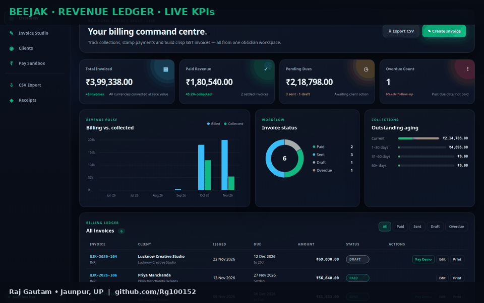
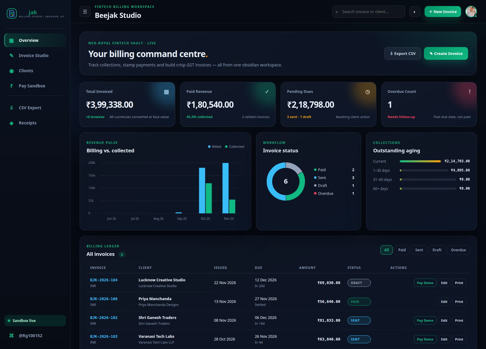
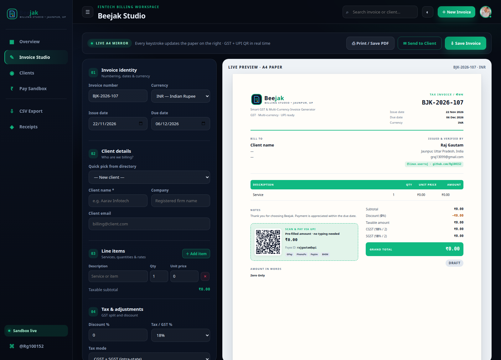
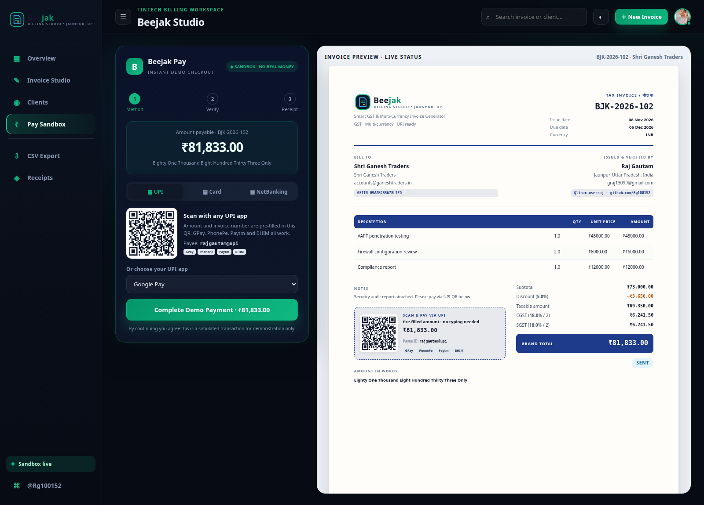

<div align="center">


[](https://www.python.org/)
[](https://flask.palletsprojects.com/)
[](https://www.sqlite.org/)
[](LICENSE)
[](https://instagram.com/linux.userraj)
[](https://en.wikipedia.org/wiki/Jaunpur)


</div>

---

## 📌 What is Beejak?

**Beejak** (बीजक — Sanskrit/Hindi for *invoice / bill*) is a production-ready, full-stack billing studio engineered by **Raj Gautam** from **Jaunpur, Uttar Pradesh, India**. It combines a Stripe/Razorpay-inspired **live A4 paper split-studio**, real-time **GST (CGST/SGST/IGST)** math, a client-side **NPCI UPI QR code** generator that works offline, a simulated **Beejak Pay Sandbox** checkout, and a revenue ledger — in one modular Flask application.

> **Tagline:** Create crisp GST/Tax invoices, preview live, print PDF & track payments.

No phone number is stored, displayed, or generated anywhere in this project. Contact is email + social only.

---

## 🎬 Live demo preview



---

## ✨ Features

| Module | Highlights |
|---|---|
| **Live A4 Split-Studio** (`/invoices/create`) | Obsidian editor on the left, warm-ivory A4 cotton paper on the right. Every keystroke mirrors instantly. |
| **GST tax engine** | 0/5/12/18/28% rates, discount %, CGST + SGST split or IGST mode, amount-in-words (Indian numbering). |
| **Dynamic UPI QR** | Valid `upi://pay?pa=…&pn=…&am=…&cu=INR&tn=…` URI rebuilt as totals change. Vendored QR renderer → works offline. Pre-filled amount badges + GPay/PhonePe/Paytm/BHIM labels. |
| **Beejak Pay Sandbox** (`/pay/<id>`) | 3-step Razorpay-style checkout: method → 1.5s verification → UTR + **PAID** stamp synced to SQLite. |
| **Receipts** (`/receipt/<utr>`) | Verified payment receipt with UTR, method, amount in words and digital seal. Print-friendly. |
| **Revenue ledger** (`/`) | 4 KPI cards, billing-vs-collected chart, status donut, aging buckets, filter tabs, status change in one click, CSV/JSON export. |
| **Client CRM** (`/clients`) | Regional client directory with GSTIN tags, profile panel and billing history. |
| **Print / Save PDF** | Dedicated `@media print` A4 stylesheet hides all editor chrome; QR, seal and PAID stamp print crisp. |
| **Branding** | Emerald / Midnight Navy / Royal Saffron accents, custom SVG receipt-stamp logo, developer credit card. |

---

## 📸 Real UI screenshots

| Revenue ledger & KPIs | Live A4 invoice builder | Beejak Pay checkout |
|---|---|---|
|  |  |  |

---

## 🔄 Data Flow Diagram

```mermaid
flowchart LR
    U[Freelancer / Business<br/>Raj Gautam] -->|Client, items, GST %| E[Beejak Split-Studio Editor]
    E -->|Vanilla JS real-time math| P[Live A4 Paper Preview]
    E -->|UPI URI builder| Q[Dynamic QR Code<br/>offline qrcode.js]
    E -->|Save invoice| DB[(SQLite3<br/>clients · invoices<br/>invoice_items · payments)]
    P -->|@media print| PDF[Client PDF / Print]
    DB -->|Ledger queries| D[Revenue KPIs & Aging Report]
    D -->|Pay Demo link| C[Checkout Sandbox]
    C -->|/api/pay/id → UTR| DB
    C -->|PAID stamp + receipt| R[Client Receipt]
```

---

## 🗂️ Project architecture (52+ files)

```text
beejak/
├── run.py                          # Flask entry point (host/port/debug CLI)
├── config.py                       # Brand constants, currencies, GST rates, accents
├── requirements.txt                # Flask, Pillow
├── .env.example                    # Environment template
├── .gitignore                      # venv, __pycache__, *.db
├── LICENSE                         # MIT © Raj Gautam
├── README.md                       # This file
├── app/
│   ├── __init__.py                 # Application factory, template filters, 404/500
│   ├── extensions.py               # SQLite connection, schema, request lifecycle
│   ├── models/
│   │   ├── __init__.py
│   │   ├── client_model.py         # Client directory queries
│   │   ├── invoice_model.py        # Invoices + line items CRUD, numbering
│   │   └── payment_model.py        # Demo payment / UTR ledger
│   ├── services/
│   │   ├── __init__.py
│   │   ├── tax_calculator.py       # Subtotal, discount, CGST/SGST/IGST
│   │   ├── upi_qr_service.py       # NPCI UPI URI builder
│   │   ├── payment_gateway.py      # Sandbox simulator + UTR generator
│   │   ├── analytics_service.py    # KPIs, monthly series, aging report
│   │   └── export_service.py       # CSV & JSON accounting exports
│   ├── routes/
│   │   ├── __init__.py
│   │   ├── dashboard_routes.py     # /, /health
│   │   ├── invoice_routes.py       # /invoices/create, edit, print, status
│   │   ├── client_routes.py        # /clients
│   │   ├── payment_routes.py       # /pay/<id>, /receipt/<utr>
│   │   └── api_routes.py           # /api/calculate, /api/pay, /api/export/*
│   └── utils/
│       ├── __init__.py
│       ├── formatters.py           # ₹ formatting, Indian amount-in-words, dates
│       └── validators.py           # Email, UPI ID, GSTIN validation
├── templates/
│   ├── base.html                   # Master layout
│   ├── components/
│   │   ├── navbar.html
│   │   ├── sidebar.html
│   │   ├── dev_card.html           # Raj Gautam developer credits
│   │   ├── toast_alerts.html
│   │   └── invoice_paper.html      # Shared live A4 sheet partial
│   ├── dashboard/index.html
│   ├── invoices/builder.html
│   ├── invoices/print_view.html
│   ├── clients/directory.html
│   ├── payments/checkout.html
│   ├── payments/receipt.html
│   └── errors/404.html, errors/500.html
├── static/
│   ├── css/
│   │   ├── variables.css           # Neo-Royal Obsidian & Emerald tokens
│   │   ├── layout.css              # Shell, split-studio, checkout grids
│   │   ├── components.css          # Glass cards, tables, modals, checkout UI
│   │   ├── invoice_paper.css       # Warm-ivory A4 paper + seals
│   │   └── print.css               # @media print A4 PDF rules
│   ├── js/
│   │   ├── core.js                 # Toasts, modals, navigation
│   │   ├── invoiceBuilder.js       # Live line items + A4 mirror sync
│   │   ├── upiQrEngine.js          # UPI URI + QR rendering
│   │   ├── demoGateway.js          # 3-step payment simulation
│   │   ├── charts.js               # Canvas revenue chart + donut
│   │   └── vendor/qrcode.min.js    # Offline QR renderer (vendored)
│   └── assets/
│       ├── logo-beejak.svg
│       ├── banner.jpg
│       ├── avatar.jpg
│       ├── screenshot-dashboard.png
│       ├── screenshot-builder.png
│       ├── screenshot-checkout.png
│       └── demo-preview.gif
├── scripts/
│   ├── seed_database.py            # 6 realistic Indian clients + invoices
│   └── make_preview.py             # Regenerates the animated GIF
├── tests/
│   └── test_billing.py             # 12 unit + smoke tests
└── database/
    └── beejak.db                   # Created automatically on first run
```

---

## ⚡ Quick start

### 🐧 Linux (Pop!_OS / Ubuntu / Debian)

```bash
git clone https://github.com/Rg100152/beejak.git
cd beejak
python3 -m venv .venv
source .venv/bin/activate
pip install -r requirements.txt
python3 scripts/seed_database.py
python3 run.py
# open http://127.0.0.1:5000
```

### 🍎 macOS (Terminal / Zsh)

```bash
git clone https://github.com/Rg100152/beejak.git
cd beejak
python3 -m venv .venv
source .venv/bin/activate
pip install -r requirements.txt
python3 scripts/seed_database.py
python3 run.py
# open http://127.0.0.1:5000
```

### 🪟 Windows — PowerShell

```powershell
git clone https://github.com/Rg100152/beejak.git
cd beejak
py -3 -m venv .venv
.\.venv\Scripts\Activate.ps1
pip install -r requirements.txt
python scripts\seed_database.py
python run.py
# open http://127.0.0.1:5000
```

### 🪟 Windows — Command Prompt (cmd)

```bat
git clone https://github.com/Rg100152/beejak.git
cd beejak
py -3 -m venv .venv
.venv\Scripts\activate.bat
pip install -r requirements.txt
python scripts\seed_database.py
python run.py
```

> If PowerShell blocks the virtualenv script, run `Set-ExecutionPolicy -Scope Process -ExecutionPolicy Bypass` first.

---

## 🌐 Routes

| Route | Purpose |
|---|---|
| `/` | Revenue KPIs, charts and filterable invoice ledger |
| `/invoices/create` | New live A4 invoice studio |
| `/invoices/<id>/edit` | Edit existing invoice with live mirror |
| `/invoices/<id>` | Clean print / PDF view |
| `/pay/<id>` | Public-style Beejak Pay demo checkout |
| `/receipt/<utr>` | Verified payment receipt |
| `/clients` | Client directory and profiles |
| `/api/calculate` | Live tax calculation JSON |
| `/api/pay/<id>` | Demo payment → PAID + UTR |
| `/api/export/csv`, `/api/export/json` | Accounting exports |

---

## 🧪 Tests

```bash
python3 -m unittest discover -s tests -v
```

Covers GST splits, IGST mode, UPI URI encoding, Indian money/words, validators, UTR format, page rendering, invoice creation, payment sync and CSV export.

---

## 🔐 Payment note

**Beejak Pay is a sandbox simulator.** No real funds move and no external payment API is contacted. The UPI QR is a standards-compliant NPCI deep link: when scanned with GPay/PhonePe/Paytm/BHIM it opens a real payment sheet with the amount and invoice note pre-filled, but the "Complete Demo Payment" button only simulates confirmation for the local SQLite ledger.

---

## 👤 Developer

<table>
<tr>
<td align="center"></td>
<td>
<strong>Raj Gautam</strong> • Jaunpur, Uttar Pradesh, India<br>
<b>Email:</b> <a href="mailto:graj13099@gmail.com">graj13099@gmail.com</a><br>
<b>Instagram:</b> <a href="https://instagram.com/linux.userraj">@linux.userraj</a><br>
<b>GitHub:</b> <a href="https://github.com/Rg100152">github.com/Rg100152</a><br>
<i>"Create crisp GST invoices, preview live, print PDF & track payments."</i>
</td>
</tr>
</table>

---


<div align="center">MIT License © 2026 Raj Gautam · Jaunpur, UP · No phone numbers anywhere.</div>
